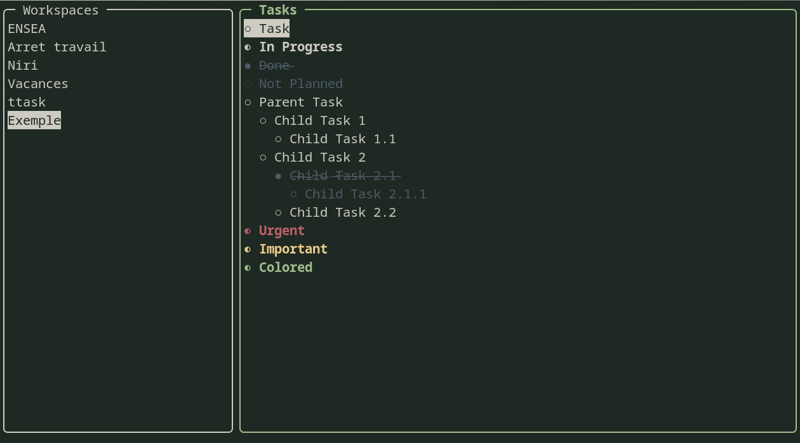

```                                                              
    ___         ___                                      ,-.  
  ,--.'|_     ,--.'|_                                ,--/ /|  
  |  | :,'    |  | :,'                             ,--. :/ |  
  :  : ' :    :  : ' :                  .--.--.    :  : ' /   
.;__,'  /   .;__,'  /      ,--.--.     /  /    '   |  '  /    
|  |   |    |  |   |      /       \   |  :  /`./   '  |  :    
:__,'| :    :__,'| :     .--.  .-. |  |  :  ;_     |  |   \   
  '  : |__    '  : |__    \__\/: . .   \  \    `.  '  : |. \  
  |  | '.'|   |  | '.'|   ," .--.; |    `----.   \ |  | ' \ \ 
  ;  :    ;   ;  :    ;  /  /  ,.  |   /  /`--'  / '  : |--'  
  |  ,   /    |  ,   /  ;  :   .'   \ '--'.     /  ;  |,'     
   ---`-'      ---`-'   |  ,     .-./   `--'---'   '--'       
                         `--`---'                             
```


# 📝 TUI Task Manager — Gestionnaire de Tâches en C

[](<>)
[](<>)
[](<>)
[](<>)

 Un gestionnaire de tâches (To-Do List) moderne, rapide et minimaliste en interface terminal (TUI). Écrit entièrement en **C** avec **ncurses**, il s'appuie sur une structure de données en **liste doublement chaînée**, offre des raccourcis clavier **Vim-style** et stocke directement vos tâches au format **Markdown**.

---

## ✨ Fonctionnalités

- 🖥️ **Interface TUI immersive :** Rendu fluide et réactif dans le terminal basé sur la bibliothèque `ncurses`.
- ⌨️ **Raccourcis type Vim :** Déplacements et actions rapides au clavier (`j`, `k`, `a`, `d`, etc.).
- 🧠 **Gestion dynamique de la mémoire :** Implémentation d'une liste doublement chaînée (`Doubly Linked List`) permettant l'ajout, la suppression et le réordonnancement efficace des tâches sans gaspillage mémoire.
- 📄 **Format de sauvegarde Markdown :** Les données sont sérialisées et sauvegardées directement dans un fichier `.md`. Vous pouvez librement éditer vos tâches depuis votre éditeur de texte préféré en dehors de l'application.
- ⚙️ **Fichier de configuration externe :** Personnalisation des paramètres d'affichage, des thèmes/couleurs et des comportements de l'application via un fichier de configuration dédié.
- 🛠️ **Build automatisé :** Compilation simple et rapide via un `Makefile` propre.

---

## 🛠️ Architecture & Choix Techniques

### Structure de données
Chaque tâche est représentée par un nœud d'une **liste doublement chaînée**, permettant une navigation bidirectionnelle instantanée et des insertions/suppressions en $\mathcal{O}(1)$ :

```text
[HEAD] <---> [ Tâche 1 ] <---> [ Tâche 2 ] <---> [ Tâche 3 ] <---> [TAIL]
```

### Persistance des données
L'application intègre un parser / sérialiseur capable de lire et d'écrire dans un fichier Markdown standard :
```markdown
- [x] Tâche terminée
- [ ] Tâche à faire
```

Il intègre aussi des états intermédiaires :
```mardown
- [~] Tâche en cours
- [-] Tâche mise de côté
```

---

## 🚀 Installation et Compilation

### Prérequis
Assurez-vous de disposer du compilateur `gcc`, de l'outil `make` et des en-têtes `ncurses`.

Sur **Linux (Ubuntu/Debian)** :
```bash
sudo apt update
sudo apt install build-essential libncurses5-dev libncursesw5-dev
```

Sur **Arch Linux** :
```bash
sudo pacman -S base-devel ncurses
```

### Compilation

1. Cloner le dépôt :
   ```bash
   git clone https://github.com/perryPyn/ttask-tui.git
   cd task-manager-tui
   ```

2. Compiler le projet avec le `Makefile` :
   ```bash
   make
   ```

3. Lancer l'application :
   ```bash
   ./ttask
   ```

---

## ⌨️ Raccourcis Clavier (Vim-Style)

| Touche | Action |
| :---: | :--- |
| `j` / `↓` | Naviguer vers le bas |
| `k` / `↑` | Naviguer vers le haut |
| `a` | **Ajouter** une nouvelle tâche (*Add*) |
| `A` | **Ajouter** une nouvelle sous-tâche |
| `x` / `Espace` | **Cocher / Décocher** la tâche sélectionnée |
| `d` | **Supprimer** la tâche sélectionnée (*Delete*) |
| `c` | **Cycler** entre les états de tâches |
| `m` | **Modifier** le texte de la tâche sélectionnée |
| `<` / `>` | Pour augmenter / réduire l'indentation |
| `r` | **Recharger** la liste |
| `q` | **Quitter** l'application (*Quit*) |

---

## 📝 Licence

Projet distribué sous licence MIT. Libre d'utilisation et de modification.
